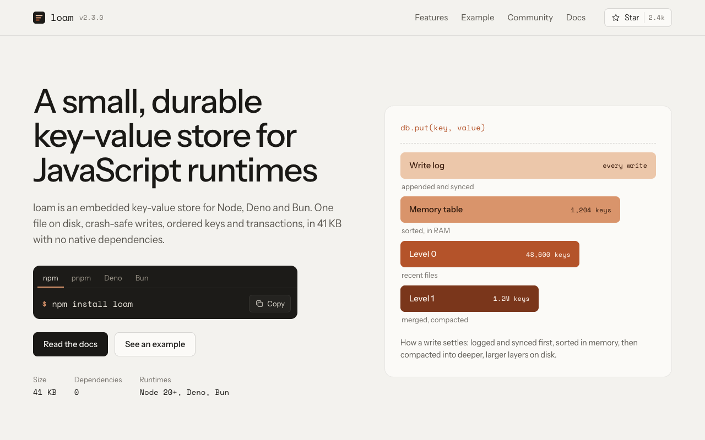

# Open-source project site

A home page for an open-source project: a hero with a copyable install command, features, a quick code example, a star count, contributors, sponsors and links to the docs and community. Built with Astro as a fully static site, with no calls to GitHub or any other API.



[](https://console.cloudzyro.com/new?repo=https://github.com/Cloudzyro/template-open-source)

## What's included

- Hero with the tagline, a short description, an install command with tabs for npm, pnpm, Deno and Bun and a copy button, and quick facts (size, dependencies, runtimes)
- A diagram drawn in HTML and CSS that explains how the project works (here, how a write settles through a storage engine's layers)
- Features list
- Quick example: captioned, syntax-highlighted code steps (highlighted at build time) with sample output
- Star count and version in the header, from your data file (no API calls, so nothing breaks when rate limits hit)
- Contributors with initials avatars, sponsors by tier, and links to docs, discussions, chat and the contributing guide
- SEO: page titles and descriptions, Open Graph and Twitter tags, `sitemap-index.xml`, `robots.txt`, favicon and a social image
- Responsive down to 360px, keyboard friendly (the install tabs work with arrow keys), visible focus styles, respects reduced motion
- No tracking and no third-party scripts; fonts are self-hosted

## Run it locally

```bash
pnpm install
pnpm dev       # http://localhost:4321
pnpm build     # static site in dist/
pnpm preview   # serve the build
```

## Make it yours

**Everything is in [`src/data/project.ts`](./src/data/project.ts):** name, tagline, description, install commands, version, license, star count, links, features, the diagram's layers, the example code and output, contributors, sponsors and community links.

**Stars and contributors.** These are plain values so the site never calls an API. Update them when you release, or have your CI write `project.ts` (for example from `gh api repos/<owner>/<repo>`) before it builds.

**The diagram.** `layers` in `project.ts` drives the bands in the hero (name, a detail line, a count and a width in percent). Replace it with whatever explains your project best, or swap the `<figure class="strata">` in `src/pages/index.astro` for a screenshot or terminal recording.

**Code example.** Each step in `example` is a caption and a code string, highlighted at build time with Shiki. Change `lang` and `theme` on the `<Code>` component in `index.astro` if your project isn't TypeScript.

**Site address.** Set `SITE_URL` (or edit the fallback in `astro.config.mjs`) so the sitemap, `robots.txt` and social previews use your domain. Copy `.env.example` to `.env` for local development.

**Colors and fonts.** The palette is at the top of [`src/styles/global.css`](./src/styles/global.css): `--accent` for links and the clay ramp (`--clay-1` to `--clay-4`) used by the diagram and avatars. Fonts are Instrument Sans and Space Mono from Fontsource, imported in `src/layouts/Base.astro`. Replace `public/og.png` (1200x630) and `public/favicon.svg` with your own.

This template has no forms, so it needs no form endpoint.

## Deploy

Click **Deploy to Cloudzyro** above, or push your own copy to GitHub and connect the repository in the Cloudzyro console. The build command is `pnpm build` and the output is the static `dist/` folder, so no server is needed.

## Stack

- [Astro](https://astro.build) 7, static output, built-in Shiki highlighting
- Hand-written CSS with custom properties
- [Fontsource](https://fontsource.org) self-hosted Instrument Sans and Space Mono
- `@astrojs/sitemap`

## License

MIT, see [LICENSE](./LICENSE).
